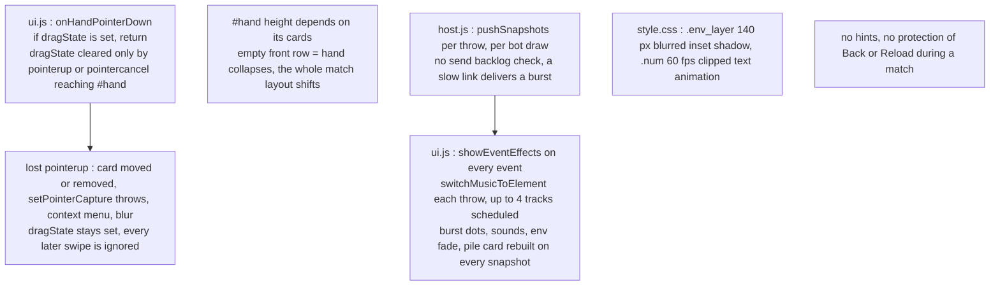

# Elemental Clash - before and after (freeze, fixed hand layout, lag, hints, match guard)

Only the flows touched by this update are drawn.

## BEFORE



## AFTER

```mermaid
flowchart TD
  G1["ui.js : attachHandGestures<br/>pointerdown on #hand, pointermove, pointerup, pointercancel, blur and visibilitychange on window"] --> G2["ui.js : onHandPointerDown<br/>ignores right click, resets any stale dragState, setPointerCapture in try and catch"]
  G2 --> G3["ui.js : onHandPointerUp<br/>dy under -60 : throwDraggedCard, dy over 60 : swapHandStacks"]
  G3 -->|"back row card swiped up"| H1["ui.js : showHint HINT_TEXTS.backRow<br/>semi-opaque #hint fades in, fades out after HINT_VISIBLE_MS"]
  R1["ui.js : renderGameScreen<br/>To ui.js : checkOutOfCardsHint in order to fade in the out-of-cards hint when the hand goes from 1 or more to 0"] --> H1
  L1["style.css : #hand fixed height card + peek, rows absolutely pinned<br/>layout identical with 0 to 10 cards"]
  P1["host.js : pushSnapshots<br/>To host.js : sendSnapshotTo in order to skip a stale snapshot when bufferedAmount is over MAX_BUFFERED_BYTES, final snapshot always sent<br/>bot draws go through requestSnapshotPush, one snapshot per 80 ms"] -->|"json t snap"| P2["ui.js : showEventEffects<br/>popups and glow always, sounds and bursts at most once per EFFECT_MIN_GAP_MS, particles capped at MAX_PARTICLES"]
  P2 --> P4["audio.js : requestMusicElement<br/>one track change per MUSIC_SWITCH_MIN_MS, scheduleStepOnTracks plays only the loudest MAX_ACTIVE_TRACKS"]
  P5["ui.js : renderPileCard<br/>rebuilds only when n or e changes, style.css : env layers are gradients on their own compositor layer, .num shimmer at 10 fps and paused for back row and locked cards"]
  M1["ui.js : showScreen id<br/>To guard.js : enableMatchGuard on game, disableMatchGuard elsewhere"] --> M2["guard.js : onMatchKeyDown blocks F5, Ctrl+R, Cmd+R, Alt+Left, Cmd+[<br/>onMatchPopState pushes history again, onMatchBeforeUnload asks before reload or close<br/>style.css html.in_match disables pull-to-refresh"]
